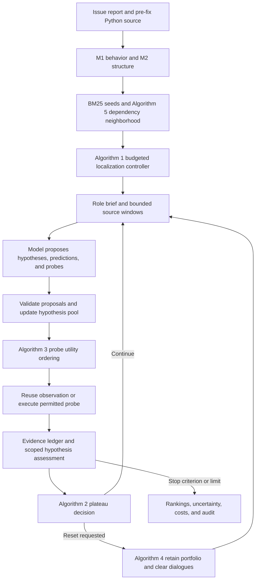

# MORPH-FL: approach, research questions, and implementation

This guide explains the approach implemented in the current Python codebase, inspected on 2026-10-20. It connects the research motivation to the algorithms, their execution order, and their source files. Research objectives are distinguished from demonstrated results. The discussion of existing approaches summarizes the project's positioning in the [proposal](MORPH-FL_Research_Proposal.md) and [baseline protocol](BASELINES.md); it is not a new literature survey or a claim that all current systems share these limitations.

MORPH-FL investigates whether **explicit, testable fault hypotheses plus evidence-preserving strategic forgetting** can improve bug localization under a limited budget. It accepts an issue report and a pre-fix Python repository, investigates candidate explanations, and returns file/function rankings with observations, uncertainty, and an audit trail. Its central separation is between **conversation memory**, which can be cleared, and **evidence memory**, which survives a reset.

## Research motivation and the problems being addressed

The unit of search is a hypothesis containing a candidate source location, an explanation of the suspected mechanism, a prediction, and a proposed investigation. A suspicious file alone does not explain why a bug happens; a persuasive explanation alone does not establish that it happens.

| Research problem | Limitation the study investigates | Implemented response | Remaining question |
|---|---|---|---|
| Symptom–cause gap | Report words and stack traces may identify where a failure appears rather than its upstream cause. A retrieval shortlist can miss a different module. | BM25 seeds, Python dependency analysis, bounded neighborhood expansion, and rotating source candidates. | Does this improve localization on cross-file and low-overlap issues? The structural expansion is not a sound causal slice. |
| Fixation on an early explanation | Accumulated dialogue can reinforce an initial suspicion and reduce exploration of alternatives. | Separate hypothesis records, a diversity heuristic, a plateau monitor, and fresh investigator contexts after resets. | Do these mechanisms improve recovery from an incorrect early lead? Clearing dialogue alone does not demonstrate reduced fixation. |
| Agreement mistaken for evidence | Multiple roles can repeat the same explanation without independently observing anything new. | Separate role dialogues, explicit predictions, scoped assessments, and one identity for a reused physical observation. | Does the resulting evidence improve causal reliability? Role agreement never creates a new empirical fact. |
| Repeated work and growing context cost | Re-reading source, repeated probes, and long dialogues can consume budget without new observations. | Probe caching, utility ranking, cumulative budgets, and selectable memory policies. | Does the full method outperform a cheaper stateless summary at equal cost? |
| Unsupported confidence | A plausible explanation or source quote can be presented as a confirmed cause. | Distinguish static facts from dynamic predictions, retain contradictions, return causal abstention, and leave confidence null. | Dynamic benchmark evidence and calibrated uncertainty remain unestablished. |

The proposal draws inspiration from restarting search while retaining useful state. Bug localization makes that harder: there is no validated scalar oracle that identifies the best causal explanation. MORPH-FL therefore retains a bounded portfolio and external observations rather than treating one hypothesis score as ground truth.

The repository includes restricted **Agentless** and **RGFL** localization component adaptations. AutoFL, AgentFL, LocAgent, and ARISE are discussed as additional comparison candidates in [BASELINES.md](BASELINES.md), not implemented reproductions. MORPH-FL's internal graph, reranking, and summary controls must not be described as complete state-of-the-art systems. Its novelty and superiority remain research questions.

## Research questions and how the code supports them

| Research question | What is being tested | Relevant implementation and comparisons | Evidence needed to answer it |
|---|---|---|---|
| **RQ1 — Effectiveness:** Does MORPH-FL localize faults more accurately than retrieval, agentic, and structure-aware alternatives, especially for cross-file and low-similarity bugs? | Whether behavioral/structural models and competing hypotheses improve file/function ranking. | Controller and transformations; BM25/graph controls; Agentless/RGFL adaptations; file/function Top-k, MRR, and set metrics. | Paired cases and seeds, sufficiently broad repository coverage, explicit difficult-case strata, and reviewed causal labels for root-cause claims. |
| **RQ2 — Mechanism:** Do model-guided hypotheses and evidence-preserving forgetting reduce fixation and improve recovery from incorrect early hypotheses? Which component matters? | Whether reset timing, retained alternatives, model memory, and skeptical investigation cause an improvement. | Plateau decisions, portfolio selection, reset audit events, component ablations, and the controller's optional `initial_clue`. | Multiple-case controlled misdirection, eligible wrong-lead recovery measurements, matched no-reset/fixed-reset/summary controls, and validated fixation measures. |
| **RQ3 — Efficiency and reliability:** At equal model/tool/token/dollar budgets, does the method provide better quality, stronger evidence, and more reliable uncertainty? | Whether improved localization or evidence justifies its cost. | Token/probe/wall budgets, physical-probe reuse, scoped evidence, abstention, cost curves, and evaluation helpers. | Matched end-to-end costs, multiple budgets, dynamic evidence, and human causal judgments. Calibration helpers alone cannot evaluate null confidence values. |

The full-study protocol and orchestration are in [experiments/full/README.md](../experiments/full/README.md) and [suite.py](../experiments/full/suite.py). They define primary comparisons, component ablations, budget curves, controlled misdirection, and reset-policy sensitivity. An executable study design or a submitted run is not a completed answer to these questions.

## The four connected model layers

All four layers are Python dataclasses in [domain/models.py](../src/morph_fl/domain/models.py), rather than an external modeling framework.

| Layer | Main records | Meaning and connections |
|---|---|---|
| **M1: behavior** | `BehavioralModel` | Report, trigger, expected/observed behavior, invariants, and ambiguities. Extraction from a report or model response remains conjectural until independently established. |
| **M2: program structure** | `SystemModel`, `Relation`, `SourceLocation` | Python source, symbols, imports/calls, approximate local def-use, revision, and source digests. Provides locations and structural links used to ground M3. |
| **M3: fault hypotheses** | `FaultHypothesis`, `Prediction` | Source locations, proposed mechanism, predictions, assumptions, conjectured causal edges, scores, and supporting/contradicting observation references. |
| **M4: investigations and evidence** | `Probe`, `Evidence`, `Assessment`, `Budget` | An executable check of a prediction, the recorded result, its scoped interpretation for a hypothesis, and cumulative resource use. |

For example, an issue might describe incorrect configuration behavior. M1 records the expected and observed behavior. M2 exposes dependencies between the visible handler and a configuration module. M3 proposes a mechanism in that module and predicts an observable condition. M4 checks that condition. A matching source line establishes source presence; it does not by itself establish that the configuration mechanism caused the reported failure. This example illustrates the workflow, not a measured diagnosis.

## How the algorithms connect

The numbering here follows the canonical [ALGORITHMS.md](ALGORITHMS.md): **five executable algorithms**. The proposal's four conceptual algorithms group the same responsibilities differently. Numbers should not be transferred between those documents without their titles.

### Algorithm 1: budgeted localization and evidence update

**Implementation:** `LocalizationController.run` and `source_window` in [search/controller.py](../src/morph_fl/search/controller.py), supported by the transformations and investigation modules below.

The controller analyzes source, ranks files with BM25, expands around up to five lexical seeds, and builds a bounded candidate list. Each round constructs a role-specific brief containing behavior, selected hypotheses, accessible observations, remaining budget, source windows, and a compact relation view. Later rounds reserve source slots for current candidates while rotating through alternatives.

The backend returns structured behavior fields and up to four hypothesis/probe proposals. The controller validates them, orders and executes permitted investigations, updates evidence and scores, records progress, and considers a reset. Invalid responses still consume their actual inference tokens.

At the end, file ranking uses the maximum live hypothesis score per path and original retrieval order for ties; with no hypotheses, retrieval order remains. Function ranking is independently derived from hypothesis locations. Outputs include observations, assessments, reset/probe statistics, costs, stop reason, and uncertainty. Internal scores are not probabilities.

### Algorithm 2: observable plateau decision

**Implementation:** `SearchSample` and `PlateauMonitor` in [search/policies.py](../src/morph_fl/search/policies.py); parameters in [search/config.py](../src/morph_fl/search/config.py).

The monitor tracks new accessible non-blocked observations, repeated physical probes, mean pairwise hypothesis distance, and actual round tokens. Adaptive reset requires enough valid investigation rounds, a full rolling window, sufficient expenditure, little evidence gain, repetition or low diversity, and enough remaining tokens for a restart plus reserve.

Defaults are a three-round window, at least four valid rounds, a 256-token reserve, zero mean evidence gain, repetition at least 0.5 or diversity below 0.5. The optional consumed-budget gate defaults to zero. These are configurable heuristics, not calibrated optimal thresholds. A reset clears the rolling window but preserves cumulative rounds and resource expenditure.

### Algorithm 3: probe utility and hypothesis portfolio selection

**Implementation:** `distance`, `rank_probes`, `select_portfolio`, and `diversity` in [search/policies.py](../src/morph_fl/search/policies.py).

Hypothesis distance combines mechanism-term Jaccard distance and different file paths:

`D(a,b) = 0.6 × lexical_distance(a,b) + 0.4 × different_path(a,b)`.

Probe priority combines a reliability weight, the number of declared alternatives, and distance from competing hypotheses, divided by estimated cost. Portfolio selection greedily combines hypothesis score with minimum distance from already selected hypotheses. The default retained portfolio is at most three hypotheses.

These heuristics encourage cheaper discriminating investigations and diverse explanations. They do not compute expected entropy reduction, semantic independence, graph-edit distance, or a guarantee of orthogonal alternatives. Probe-ID filtering and the controller's physical-probe cache serve different purposes: differently worded hypotheses can share one physical observation.

### Algorithm 4: evidence-preserving context reset

**Implementation:** the reset branch of `LocalizationController.run`, `InvestigatorSessions.forget` in [agents/sessions.py](../src/morph_fl/agents/sessions.py), `select_portfolio`, and `fresh_context` in [transformations/pipeline.py](../src/morph_fl/transformations/pipeline.py).

The controller selects retained hypotheses per scope, clears role dialogues, clears the plateau window, and records a reset event. It checks that the ledger's observation-ID set is unchanged. On the next round, a fresh brief is derived from retained models, accessible observations, unresolved predictions, and remaining budget.

The reset preserves all recorded observations, artifacts, physical-probe cache, and incurred cost. It can discard hypotheses outside the selected live portfolio; their prior records remain in the audit. The `context_only` condition retains all live hypotheses. Evidence retention does not establish that every useful conversational insight has been captured or that observations prove causality.

### Algorithm 5: conservative dependency-neighborhood composition

**Implementation:** `compose_slice` in [transformations/pipeline.py](../src/morph_fl/transformations/pipeline.py), using `analyze_python` in [program_analysis/python.py](../src/morph_fl/program_analysis/python.py).

Starting with seed file paths, the algorithm expands both ways over resolved relation endpoints for two hops by default. It preserves seeds and adds existing connected source paths. Unresolved relations do not drive expansion. The controller combines this neighborhood with retrieval order rather than permanently excluding all files outside it.

Despite the function's name, this is a bounded structural neighborhood, not a minimal semantic slice or sound interprocedural causal analysis.

## Transformations T1–T7

| Transformation | Actual function and file | Connection to the workflow |
|---|---|---|
| **T1: report → behavioral model** | `complaint_to_contract`, [pipeline.py](../src/morph_fl/transformations/pipeline.py) | Creates M1 initially and refines scoped behavior fields from valid model responses. |
| **T2: source → system model** | `analyze_python`, [python.py](../src/morph_fl/program_analysis/python.py) | Constructs M2 with versioned symbols, relations, and unresolved-analysis diagnostics. |
| **T3: structural composition** | `compose_slice`, [pipeline.py](../src/morph_fl/transformations/pipeline.py) | Expands lexical seeds through known dependencies for candidate preparation. |
| **T4: hypothesis synthesis** | `synthesize`, [pipeline.py](../src/morph_fl/transformations/pipeline.py) | Materializes M3 from a model proposal; validates paths/lines/predictions and marks causal edges conjectured. The controller additionally requires a visible source path. |
| **T5: hypothesis → probe** | `hypothesis_to_probe`, [pipeline.py](../src/morph_fl/transformations/pipeline.py) | Converts the jointly proposed investigation parameters into a typed probe with cost/reliability weights. |
| **T6: observation → assessment** | `evidence_update`, [pipeline.py](../src/morph_fl/transformations/pipeline.py) | Interprets the explicit predicate, appends support/contradiction references, and changes the hypothesis score. |
| **T7: models/evidence → fresh brief** | `fresh_context`, [pipeline.py](../src/morph_fl/transformations/pipeline.py) | Builds the next role's view and distinguishes static observations from dynamic prediction support. |

T4/T5 validate jointly generated hypotheses and probe plans. They are not a verified compiler that can automatically derive a correct executable test from any causal explanation.

## Investigation, evidence, and stopping semantics

`ProbeExecutor` in [investigation/executor.py](../src/morph_fl/investigation/executor.py) supports source quotations, AST queries, tests, traces, and counterfactual procedures. Source probes check a quote against a numbered line; AST probes check an allowed syntactic predicate. Dynamic probes require configured, registered Apptainer procedures and a pinned image digest. Missing procedures, unavailable execution, and timeouts yield blocked/inconclusive outcomes. A counterfactual compares registered baseline and intervention procedures.

`EvidenceLedger.add` in [investigation/ledger.py](../src/morph_fl/investigation/ledger.py) checks revision, source provenance, and artifact integrity, and rejects attempts to overwrite an observation. The controller caches physical checks by kind, path, and parameters within the run. A reused observation can be assessed against another hypothesis without becoming a second independent fact.

`evidence_update` assigns a supports/contradicts/inconclusive verdict with limited scope. Source presence carries weight 0.25, AST evidence weight 1, and other supported investigation evidence weight 2; contradictions subtract the corresponding weight. These weights are heuristic. Static matches do not validate a full causal chain.

The loop ends at round/token/probe/wall limits, backend context limits, or a conservative criterion involving at least two distinct registered dynamic procedures supporting a leader with declared assumptions and no contradictions. Returned causal abstention is computed separately: without a supporting dynamic causal-prediction assessment, it remains true. Thus a static-only run can return useful rankings while abstaining from a causal conclusion. Confidence remains `None`.

## Investigator roles and controlled variants

The default schedule is **behavioral → skeptical → structural → dynamic**, repeated sequentially through one model backend. Each role has its own dialogue. The behavioral role clarifies expectations, the skeptical role challenges the leader, the structural role follows dependencies, and the dynamic role proposes registered tests/traces. Two-round runs exercise only the first two roles. Role definitions are in [sessions.py](../src/morph_fl/agents/sessions.py); execution order comes from [config.py](../src/morph_fl/search/config.py).

| Condition | Implemented change | Main comparison purpose |
|---|---|---|
| `morph` | Full configured loop with adaptive forgetting. | Proposed combination. |
| `no_forgetting` | Retain role dialogues across rounds. | Contribution of resets. |
| `fixed_reset` | Reset at a fixed interval, default three rounds. | Adaptive versus periodic resets. |
| `context_only` | Adaptive resets retain all live hypotheses. | Contribution of portfolio pruning. |
| `single_hypothesis` | Portfolio size one. | Contribution of multiple retained alternatives. |
| `no_mde` | Replace agent-visible typed model memory with an evidence-text summary. | Contribution of explicit model presentation. |
| `no_probes` | Skip investigations; use small proposal-order scores. | Contribution of observation-based updates. |
| `no_skeptic` | Remove the skeptical role from the schedule. | Contribution of explicit falsification guidance. |
| `independent_agents` | Isolate role-specific hypothesis, behavior, and evidence views; aggregate final results. | Shared versus isolated investigation state. |
| `one_agent` | Repeatedly use the structural role. | Contribution of role diversity. |
| `stateless_summary` | Omit prior dialogue on each call and use evidence-text memory. | Cheap summary-based alternative. |
| `rerank` | One model round without forgetting. | Short-budget model comparison. |
| `bm25` | Return lexical ranking without model rounds. | Retrieval-only control. |
| `graph` | Prioritize dependency-neighborhood files with retrieval-order ties; no model rounds. | Simple structure-aware control. |

The `no_mde` and summary variants still use internal typed validation, execution, and scoring. They do not remove every model object. Roles are sequential scheduling conditions, not separate concurrent GPU workers.

## Main project aspects mapped to implementation

Paths below identify the actual implementation rather than compatibility facades such as `engine.py` or `models.py`.

| Project aspect | Main implementation | Responsibility / related verification |
|---|---|---|
| Public CLI | [cli.py](../src/morph_fl/cli.py) | Parses commands and dispatches run, preparation, scoring, and import services. |
| Durable case execution | [application.py](../src/morph_fl/application.py), `run_cases` | Case-level persistence, resume validation, and scoring services; [test_application.py](../tests/unit/test_application.py). |
| Domain models and cumulative budgets | [domain/models.py](../src/morph_fl/domain/models.py) | M1–M4 dataclasses, status, identity, evidence references, and token charging. |
| Python structural analysis | [program_analysis/python.py](../src/morph_fl/program_analysis/python.py) | AST symbols, imports/calls, approximate local flow, and resolution diagnostics; [test_deep_python_analysis.py](../tests/unit/test_deep_python_analysis.py). |
| Lexical indexing and retrieval | [program_analysis/retrieval.py](../src/morph_fl/program_analysis/retrieval.py), `index`, `bm25` | Source discovery and report-to-file ranking. |
| Model transformations | [transformations/pipeline.py](../src/morph_fl/transformations/pipeline.py) | T1/T3–T7 and Algorithm 5; [test_method.py](../tests/unit/test_method.py). |
| Localization coordination | [search/controller.py](../src/morph_fl/search/controller.py) | Algorithm 1, cache reuse, reset execution, rankings, stopping, and audit events; [test_controller.py](../tests/unit/test_controller.py). |
| Plateau, utility, diversity | [search/policies.py](../src/morph_fl/search/policies.py) | Algorithms 2/3 and portfolio support for Algorithm 4; [test_reset_policy.py](../tests/unit/test_reset_policy.py). |
| Parameters and ablations | [search/config.py](../src/morph_fl/search/config.py) | Immutable `SearchConfig`, fourteen variants, and reset fields. |
| Investigator conversations | [agents/sessions.py](../src/morph_fl/agents/sessions.py) | Role instructions, structured response contract, dialogue recording, and forgetting. |
| Static/dynamic probes | [investigation/executor.py](../src/morph_fl/investigation/executor.py) | `ProbeExecutor`, `SandboxConfig`, registered procedure execution, and observation artifacts. |
| Evidence identity and integrity | [investigation/ledger.py](../src/morph_fl/investigation/ledger.py) | Version/integrity checks, immutable observation entries, and deduplication. |
| Artifact and audit storage | [infrastructure/artifacts.py](../src/morph_fl/infrastructure/artifacts.py) | `ArtifactStore` and hash-linked `AuditLog`; [test_storage.py](../tests/integration/test_storage.py). |
| Model backend interface | [inference/protocol.py](../src/morph_fl/inference/protocol.py) | Common `ModelBackend` contract. |
| Local model inference | [inference/local.py](../src/morph_fl/inference/local.py), [inference/ollama.py](../src/morph_fl/inference/ollama.py) | Transformers and Ollama adapters, response parsing, provenance, and token accounting. |
| Public benchmark inputs | [datasets/contracts.py](../src/morph_fl/datasets/contracts.py), [datasets/swebench.py](../src/morph_fl/datasets/swebench.py) | Public-case validation and pinned pre-fix SWE-bench preparation. |
| Evaluator-only labels | [datasets/labels.py](../src/morph_fl/datasets/labels.py), `patch_labels` | Maps reference-patch changes to pre-fix production file/function proxies. Gold patches stay outside investigator context. |
| Defects4J adapter | [datasets/defects4j.py](../src/morph_fl/datasets/defects4j.py) | Export support; does not provide the missing Java analysis/localization pipeline. |
| Localization/cost metrics | [evaluation/metrics.py](../src/morph_fl/evaluation/metrics.py) | Top-k/MRR, set metrics, selective accuracy, calibration helpers, and cost–accuracy AUC. |
| Statistical analysis | [evaluation/statistics.py](../src/morph_fl/evaluation/statistics.py) | Bootstrap, clustered sign-flip, and Holm-adjustment helpers. |
| External comparison adapters | [baselines/local.py](../src/morph_fl/baselines/local.py), [baselines/vendor/prompts.py](../src/morph_fl/baselines/vendor/prompts.py), [baselines/vendor/compress_file.py](../src/morph_fl/baselines/vendor/compress_file.py) | Restricted Agentless/RGFL stages and vendored components; [test_upstream_baselines.py](../tests/unit/test_upstream_baselines.py). |
| Imported external predictions | [evaluation/external.py](../src/morph_fl/evaluation/external.py) | Agentless artifact conversion; imported unmatched runs remain distinct from matched experiments. |
| Exploratory and policy studies | [experiments/baselines](../experiments/baselines/README.md), [experiments/alignment](../experiments/alignment/README.md) | Baseline comparisons and separately versioned reset-policy diagnostics. |
| Full-study execution and analysis | [suite.py](../experiments/full/suite.py), [analyze.py](../experiments/full/analyze.py), [extended_analysis.py](../experiments/full/extended_analysis.py) | Model/seed/track execution, coverage checks, paired analysis, recovery and retention summaries; [test_full_study.py](../tests/unit/test_full_study.py). |
| Cluster orchestration | [hpc/scripts/run_stage.py](../hpc/scripts/run_stage.py), [hpc/slurm/submit.py](../hpc/slurm/submit.py), [hpc/ufv/README.md](../hpc/ufv/README.md) | Staging, scheduling, resume, collection, and UFV operations. |

The test references identify relevant checks; unit tests establish implementation behavior, not scientific effectiveness.

## What is established and what remains open

The code implements linked models, a sequential investigation loop, explicit evidence scopes, heuristic probe/portfolio selection, adaptive and fixed reset policies, evidence retention, budget accounting, and comparison workflows. Python analysis is approximate; arbitrary-language localization, sound interprocedural slicing, calibrated confidence, and automatic causal verification are not implemented capabilities.

The repository's exploratory comparisons report mixed or unfavorable evidence for a consistent MORPH-FL advantage; the stateless summary remains competitive and cheaper in reported conditions. Retention checks establish preservation of recorded observation IDs at measured resets, not better wrong-lead recovery or zero semantic information loss. Short two-round studies cannot establish the benefit of adaptive long-horizon forgetting. See the measured RQ findings summarized in the [claim-alignment matrix](CLAIM_ALIGNMENT.md) and the [baseline experiment protocol](../experiments/baselines/README.md).

The current full-study README describes a five-family, three-seed Lite/Verified design and reports submission of a corrected run. This guide does not independently verify live cluster state or claim completed full-study performance. Historical experiments used frozen source/configurations and must be interpreted under those versions, rather than attributed to every later code change.

Finally, the principal labels are **unreviewed patch-change proxies**, not human-adjudicated causes. Static-only runs do not establish runtime causal explanations. Full dynamic benchmark validation, stronger external reproductions, broader repeated evaluation, and reviewed causal labels remain necessary before claiming that the proposed combination resolves the research problems.
