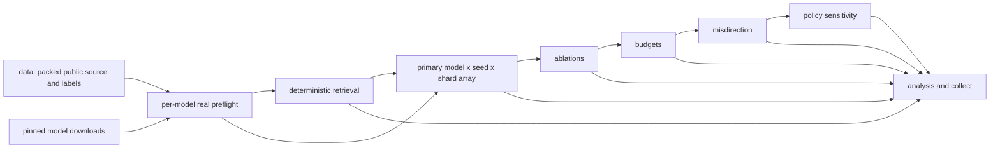

# MORPH-FL full evaluation on Nibi

## Scope, authorization, and current status

The user authorized full SWE-bench Lite (300) and Verified (500), staged execution with **at most four concurrent H100 allocations**, collection, and subsequent TSE manuscript revision. Java/Defects4J and BugsInPy follow later. See the frozen [full-study protocol](../../experiments/full/protocol.json), [model evidence](../../experiments/full/models.md), and [design](../../experiments/full/README.md).

This pipeline reuses the installed [use-hpc skill](https://github.com/ai4se4ai-lab/use-hpc). Its scaffold kept every existing generic scheduler/audit file. It replaces the earlier one-model/Lite-only experiment configuration, preserved as `experiments/full/previous_hpc_config.json`. Prior model implementations and historical prediction sources are not modified or relabeled.

No completed full benchmark is claimed. The earlier Nibi BF16 run was partial. Full-study smoke attempt `am-smoke-20261019-154917` in deployment `MORPH-FL-full-v1` failed before experiment steps because LibCST 1.9.0 was unavailable; its remaining dependent jobs were cancelled. The next deployment uses the available `libcst==1.8.6` wheelhouse version, with an explicit preflight gate on every heavy track. Current run IDs and receipts are recorded in `experiments/full/status.json` when available.

## Phase 1 inventory and source map

| Question/component | Subjects/factors | Executable entry point | Decision/output |
|---|---|---|---|
| RQ1 primary accuracy | Every unique Lite/Verified test issue; four models; seeds 1/2/3; six workflows; 32k tokens, up to16 rounds | `experiments.full.suite run --track main` | File/function Top-k, MRR, explicit eligibility; one benchmark summary each with overlap disclosed |
| Retrieval controls | Same full union, deterministic BM25/graph once each | `--track retrieval` | No repeated model/seed pseudo-replication |
| RQ2 component effects | Fixed 100-issue repository-balanced report-blind sample; eight ablations | `--track ablations` | Compare with matching primary cases; model/evidence visibility boundaries remain explicit |
| RQ2 memory mechanism | Primary continuous, adaptive, fixed, summary conditions, actual reset events | `--track main` | Observation retention, resets, duplication, hypothesis switches; no reset occurrence presumed |
| RQ2 wrong-lead recovery | Same fixed sample; four memory conditions | `--track misdirection` | BM25 rank2 clue generated without labels; report wrongness, actual following, recovery denominators |
| RQ2 policy sensitivity | Fixed sample; windows3/4/5, fraction .15 | `--track policy` | Operational sensitivity, not automatic optimum selection |
| RQ3 budgets | Same fixed sample; four memory methods; 16k/32k/48k | `--track budgets`, matching32k primary records | Measured quality/token curves, no extrapolation; actual costs also recorded |
| RQ3 evidence/reliability | All observations and assessment scopes | Core ledger/audit and final analysis | Static provenance and null confidence; no fabricated calibration or causal judgments |
| Pinned inputs | All issues, overlap deduplication, public snapshots vs labels | `experiments.full.prepare` | Data manifest, packed source hashes, public cases and separate proxy labels |
| Inference | Four native instruction checkpoints, BF16/context16384/T.2/top-p.95/top-k50 | `experiments.full.inference.NativeModel` | Actual tokens, pinned metadata, all parameters on allocated GPU |
| Scoring/statistics | All completed records, eligible labels, repository clusters | `experiments.full.analyze`, `extended_analysis` | Exact-key completeness, case-seed means, paired intervals, predeclared Holm family |
| Paper promotion | Complete non-smoke full results only | `experiments.full.paper_update` | Generated TeX/tables/figures/provenance; refuses incomplete or smoke evidence |

Model checkpoints: Qwen2.5-Coder7B/32B, Qwen3-Coder30B-A3B, DeepSeek-Coder6.7B-Instruct. Exact commit hashes are in `pins.json`. They include a small pilot-continuity configuration, competitive dense/MoE configurations, and an ICSE-used historical cross-family control. No claim that these are universally best or all evaluated in the same venue is made. There is no unverified TSE attribution.

## Job graph and resource requests



All heavy tracks also require successful model preflight. Primary/side arrays are sequential stages with throttle4, so independent arrays cannot silently request16 GPUs. Retrieval finishes before main; small preparation stages occupy at most three MIG allocations. Four-model preflight uses at most four full H100s. Collection follows all heavy tracks. Model/source downloads and dataset preparation occur only in GPU jobs with internet explicitly enabled; later inference is offline.

| Stage | Full task cells | GPU/task | CPU/memory | Initial time/task |
|---|---:|---|---|---|
| data | 1 | H1001g10GB MIG | 2/16G | 12h |
| model_assets | 4, throttle2 | H1001g10GB MIG | 2/16G | 4h |
| model_preflight | 4, throttle4 | Full H10080GB | 8/128G | 12h |
| retrieval | 1 | H1001g10GB MIG | 2/16G | 2h |
| main | 384 (4models ×3seeds ×32shards), throttle4 | Full H10080GB | 8/128G | 12h |
| ablations | 48, throttle4 | Full H10080GB | 8/128G | 12h |
| budgets | 48, throttle4 | Full H10080GB | 8/128G | 12h |
| misdirection | 48, throttle4 | Full H10080GB | 8/128G | 12h |
| policy | 48, throttle4 | Full H10080GB | 8/128G | 12h |
| collect | 1 | H1001g10GB MIG | 2/16G | 2h |

Ten sbatch submissions, 587 task cells. At the800-unique-subject upper bound:57,600 primary LLM records +27,600 side-study LLM records +1,600 deterministic controls =86,800 total; overlap reduces actual primary/control counts. Main/side initial reservation ceiling:6,912 full-H100 hours, not an estimated actual consumption. At most two requeues can triple that ceiling; each resumes completed cases. Queue latency and measured throughput determine elapsed completion time. A large run is not a one-turn result.

Smoke retains every stage, but one model/seed/shard and one issue per track:6 main +8 ablation +4 budget +4 misdirection +1 policy +2 retrieval records =25 inference/control records, plus separate6-workflow preflight records. The7B smoke uses20GB MIGs rather than full H100s; full-study resources stay unchanged. Stage time limits are15min. Genuine preflight requires actual output tokens and valid hypotheses; a successful scheduler exit alone cannot satisfy it. Final smoke analysis must be nonempty and exact-key complete. Smoke output is never promoted to paper results.

## Scientific coverage and remaining gaps

| Paper claim/table/figure | Stage → output | Final decision rule |
|---|---|---|
| File/function comparisons | main → `predictions/*.jsonl`, `scores/*.csv`, `analysis/summary.csv` | Three seeds and all unique benchmark IDs present; eligible counts explicit |
| All component controls | ablations → same plus track metadata | Same report-blind100-subject set; compare matching main cases, not all-case averages |
| Benefits of forgetting | main/policy → audit reset and round events, `analysis/reset_retention.json` | Verify actual reset incidence; record retention alone does not prove recovery |
| Recovery after wrong lead | misdirection → `analysis/recovery.json`, `recovery_summary.csv` | Proxy-wrong clue AND first valid leader follows it; preserve unconditional counts |
| Token efficiency/budget line chart | budgets+matching main → `budget_points.csv`, `budget_curves.pdf` | Same sample, fixed ceilings, actual token usage retained |
| Case/model/method heatmap | analysis → `heatmap.pdf` | Only measured cells, missing cells remain missing |
| Top-k line charts | analysis → `SWE-bench_*-topk.pdf` | Observed k1/5/10 only; no invented cost trajectory |
| Paired uncertainty | analysis → `paired.json` | Average seeds within case, bootstrap repository clusters |
| Primary testing family | extended_analysis → `primary_comparisons.json` | File Top1: five comparators ×four models ×two benchmarks; Holm across family; no confirmatory claim for partial/smoke data |
| Calibration/causal evidence | `analysis/rq_coverage.json` | Confidence null; calibration and human causal validity remain unmeasured |
| Full-run completion | `analysis/completeness.json`, pipeline ledger | Exact expected keys equal observed, all step receipts and model gates accounted for |
| TSE result promotion | `paper_update.py` | Reject smoke/partial, require four models/six workflows/three seeds/full benchmark coverage |

The paper's central causal/fixation hypothesis is not automatically established by scale. Labels remain unreviewed patch-change proxies. Dynamic Apptainer benchmark reproductions, independently rated causal chains and true mechanism diversity, human ground-truth adjudication, complete upstream graph/embedding/tool pipelines, and second-language analyses remain missing. The pipeline states these gaps rather than claiming all aspects of every RQ are answered. Calibration cannot be computed from null confidence.

## Storage, provenance, and resumability

At read-only preflight, home was49/50GiB, scratch682/1024GiB with685k/1M files, project17/931GiB. No unrelated files were deleted. Keep all caches out of home. Full Python snapshots are packed and hashed, then extracted one-at-a-time on `$SLURM_TMPDIR`; no Git history, patches or post-fix tests enter the public snapshot. Model inputs receive source/probe payloads, not evaluator labels. Benchmark-overlap conflicts fail preparation rather than silently choosing a version.

Each cell appends/fsyncs completed records, freezes settings/source/protocol identities, and safely repairs only a truncated last record. Static model payloads are hash-deduplicated; per-case prompt/evidence directories are archived with original-root mappings and digests. This reduces shared inode pressure without deleting audited content. Final collection preserves packed records and graphs on project storage. Scratch remains purged/not backed up; the collected project copy is the durable artifact.

## Operations

Remote code is deployed to a **new versioned project directory** rather than overwriting code used by queued or historical runs. Account `def-mbabaei_gpu` and site H100/MIG names were checked. Modules: `StdEnv/2023 python/3.11.5 arrow/24.0.0`. Virtualenvs use the Alliance wheelhouse on compute nodes; LibCST1.8.6 is available. No model install/download/analysis runs on login nodes.

```bash
bash hpc/scripts/selftest.sh
python3 hpc/slurm/submit.py --dry-run --smoke
python3 hpc/slurm/submit.py --smoke --account def-mbabaei_gpu
bash hpc/status.sh SMOKE_RUN_ID
# After every smoke cell is OK, valid inference is checked and tables are nonempty:
python3 hpc/slurm/submit.py --account def-mbabaei_gpu
bash hpc/status.sh FULL_RUN_ID
# Repair/resume uses frozen configuration and skips completed work:
python3 hpc/slurm/submit.py --run-id FULL_RUN_ID --only main,ablations,budgets,misdirection,policy,collect
```

Audit at most once per minute; do not start tight monitor loops. The ledger/audit distinguishes scheduler completion from missing step receipts, empty inference and partial coverage. Avoid resubmitting a running cell concurrently: output JSONL has one owning array task.

After collection, copy the collected result tree (plus analysis/data manifests) locally and use the guarded paper exporter. Compile and inspect the updated PDF, assess actual outcomes and paired intervals, and revise abstract/conclusions accordingly. A generated table or a completed Slurm job does not warrant stronger claims. Previous exploratory results remain archived with their original versions.

## One-shot continuation and PDF export

The final smoke runs all15 steps, including a real pinned Tectonic/compiler-cache preflight on a GPU node. Continuation job24601530 depends on smoke collect24601434. `hpc/scripts/continue_full.py` additionally validates every successful step receipt, actual valid hypotheses/tokens, exact smoke coverage and nonempty collected tables before calling the authorized full submitter. Its `full_continuation.json` records the actual full run ID/jobs; it refuses duplicate submission on retry. This is scheduler-driven continuation, not a monitoring loop.

The final collect stage exports complete non-smoke TeX results and compiles the paper offline with the setup-cached Tectonic0.17.0 asset (SHA-256 pinned in `experiments/full/typeset.py`). URW font files and their license/font exception accompany the manuscript so fonts resolve on Nibi without OS installs. Smoke or partial data produce deferred export/type-setting receipts. The resulting PDF is explicitly for outcome-level scientific review; no automated exporter establishes a positive effect or acceptance readiness.
